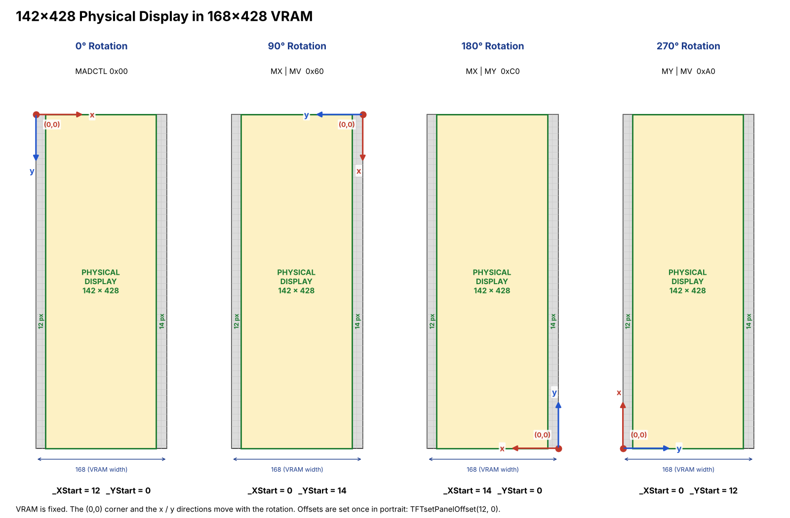
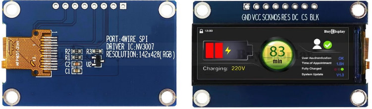

# NV3007 Readme

## Table of contents

* [Overview](#overview)
* [Installation](#installation)
* [Dependency](#dependency)
* [Documentation](#documentation)
* [Software](#software)
  * [Dependency user options](#dependency-user-options)
  * [Examples](#examples)
  * [Panel selection](#panel-selection)
  * [Setup](#setup)
* [Hardware](#hardware)

---

## Overview

* Name: NV3007_LTSM
* Description:

Arduino C++ library for a TFT SPI LCD, NV3007 Driver IC.

NV3007 is a single-chip driver for 262,144-color, a-Si TFT liquid crystal display
with maximum resolution of 168(RGB)x428 dots. It contains 252-channel source driver,
a 24-channel GIP driver which used for dual-gate control, 161,784-byte GRAM for
graphic display data, internal precise power supply circuit which supports full color, 8-color display mode and sleep mode.

1. Power modes, Invert, Scroll, Rotate, Bitmaps supported.
2. Hardware & software SPI
3. Supports the buydisplay 1.65 inch and 2.79 inch NV3007 panels, both 142x428, see [Panel selection](#panel-selection)
4. Arduino eco-system library.
5. 16 ASCII fonts included, fonts can easily be removed or added.
6. Advanced graphics class included.
7. Advanced frame buffer mode included.
8. Bitmaps supported: 1, 8 and 16 bit.
9. Sprites supported.
10. [Project url link](https://github.com/gavinlyonsrepo/NV3007_LTSM)
11. [DataSheet](https://www.buydisplay.com/download/ic/NV3007.pdf)
12. Donations Welcome: [](https://www.paypal.com/paypalme/whitelight976)

## Installation

The library is included in the official Arduino library manger and the optimum way to install it is using the library manager which can be opened by the *manage libraries* option in Arduino IDE.

## Dependency

This library requires the Arduino library 'display16_LTSM' as a dependency. display16_LTSM library contains
the graphics, bitmaps, and font methods as well as font data and bitmap test data. Its also
where the user sets options(debug, advanced graphics and frame buffer mode).
When you install 'NV3007_LTSM' with Arduino IDE. It should install 'display16_LTSM' as well after
a prompt, if it does not you have to install it same way as 'NV3007_LTSM'.
The 'display16_LTSM' project and readme is at [URL github link.](https://github.com/gavinlyonsrepo/display16_LTSM)
'display16_LTSM' is also written by author of this library.

## Documentation

Code is commented for the 'doxygen' API generation tool.
Documents on fonts, bitmaps and graphics can be found at
the dependency 'display16_LTSM' repository, [URL github link](https://github.com/gavinlyonsrepo/display16_LTSM)

## Software

### Dependency user options

There are options in the dependency 'display16_LTSM' library which can be set by the user.
These are set in the 'display16_LTSM' library's 'display16_common_LTSM.hpp' file.
These options are referenced in note section of example files table below.
See dependency section of this readme for url link to display16_LTSM for more information on the options.
The options are:

| Option | Description | Default |
| --- | --- | --- |
| dislib16_ADVANCED_GRAPHICS_ENABLE | Enable advanced graphics functions | OFF |
| dislib16_ADVANCED_SCREEN_BUFFER_ENABLE | Enable advanced screen buffer mode | OFF |
| dislib16_DEBUG_MODE_ENABLE | Enable debug messages to serial console | OFF |

### Examples

There are example ino files included.

| Filename | Function | Note |
| --- | --- | --- |
| HELLO | Hello world | - |

More examples will be included in next version. In meantime
user can look at other similar displays that use the [graphics library.](https://github.com/gavinlyonsrepo/display16_LTSM)

### Panel selection

The NV3007 comes in two known versions that use the same controller
and have the same pixel size (142x428), but they need **different init sequences**
(gamma, power, GOA and source control values differ). The two panels also share the
same GRAM size and the same offsets, so only the init sequence is panel specific.
Using the init sequence of the wrong panel can give a corrupted picture
(for example blank alternate rows and columns).

The panel is selected at compile time with a define in the library header file
'NV3007_LTSM.hpp', so only the init sequence for the selected panel is compiled in.
Define exactly ONE panel:

| Define | Panel | Pixel size |
| --- | --- | --- | 
| NV3007_PANEL_165 (default) | 1.65 inch | 142x428 |
| NV3007_PANEL_279 | 2.79 inch | 142x428 |

```cpp
#define NV3007_PANEL_165  // 1.65 inch, buydisplay TFTM1.65-2
//#define NV3007_PANEL_279  // 2.79 inch, buydisplay TFTM2.79-2
```

### Setup

In the ino example files. There are sections in "setup()" function
where user can make adjustments.

0. SETUP OPTION 0 SPI_SPEED, GPIO + TYPE
1. SETUP OPTION 1 Screen size + options
2. SETUP OPTION 2 Screen offsets

#### SETUP OPTION 0 SPI SPEED + GPIO + TYPE

A bool variable is used to decide of hardware or software init function is called
Here the user can pass the SPI Bus freq in Hertz, Currently set to 8 Mhz.
If users wants software SPI just call this method
with just one argument for the optional GPIO software uS delay,
which by default is zero. Setting this higher can be used to slow down Software SPI
which may be beneficial in some setups.

The 5 GPIO pins used, the clock and data lines must be the clock and data lines
of SPI bus in hardware SPI mode.

#### SETUP OPTION 1 Screen size + options

User can adjust display size (width & height) in pixels,
and colour order (RGB or BGR).

#### SETUP OPTION 2 Offsets and rotation

The NV3007 has a fixed GRAM (VRAM) of 168 x 428 pixels.
The known display panels are narrower than the GRAM, so the visible area does not start at column 0 of the GRAM. These truncated displays require an offset. The panel size and the offsets are both configurable
in case other panel sizes appear on the market.
Known display types on the market with the NV3007 controller:

| Display Type | VRAM size (fixed) | Panel size setup (WbyH) | Offsets (col, row) |
| --- | --- | --- | --- |
| 142x428 Truncated 1.65 inch  | 168 x 428 | 142 , 428 | 12 , 0 |
| 142x428 Truncated 2.79 inch  | 168 x 428 | 142 , 428 | 12 , 0 |

Both panels use the same size and offsets, the panel type itself is chosen
in the header, see [Panel selection](#panel-selection).
Why 12? The 142 pixel wide pane lsits in 168 VRAM columns, so 26 columns are unused. They are not split equally: 12 are to the left of the panel and 14 to the right. Set the offsets **once**, using the portrait (rotation 0) values, then change the rotation at any time with TFTsetRotation. The library works out the offsets for the other rotations.

```cpp
uint8_t X_Offset = 12; // columns before the panel in portrait
uint8_t Y_Offset = 0;  // rows before the panel in portrait
myTFT.TFTsetPanelOffset(X_Offset, Y_Offset);
myTFT.TFTNV3007Initialize();
myTFT.TFTsetRotation(myTFT.Degrees_0);
```

1. Call TFTsetPanelOffset before the init function. If it is called after init,
the new values are only used at the next TFTsetRotation call.
2. The defaults are 12 and 0, so for the two known panels the call can be left out.
3. The offsets are checked at init, if the panel size plus the offset does not fit in the
168 x 428 VRAM, the values are corrected and a warning is printed in debug mode.

| Rotation | MADCTL | X start | Y start | Values for 142x428, offsets (12, 0) |
| --- | --- | --- | --- | --- |
| 0 | none | col offset | row offset | X = 12, Y = 0 |
| 90 | MX, MV | row offset | 168 - width - col offset | X = 0, Y = 14 |
| 180 | MX, MY | 168 - width - col offset | 428 - height - row offset | X = 14, Y = 0 |
| 270 | MY, MV | 428 - height - row offset | col offset | X = 0, Y = 12 |

Width and height are the portrait panel size passed at setup (142 and 428).

[](https://github.com/gavinlyonsrepo/NV3007_LTSM/blob/main/extras/images/nv3007_offsets.png)

## Hardware

[](https://github.com/gavinlyonsrepo/NV3007_LTSM/blob/main/extras/images/nv3007all.jpg)

Connections as setup in the ino example file for ESP32:

| Pin description | HW SPI | SW SPI |
| --- | --- | --- |
| GND Ground | GND | GND |
| VCC | 3.3 VCC | 3.3 VCC |
| SCL Clock | 18 | 27 |
| SDA Data in -> MOSI | 23 | 26 |
| RST Reset | 4 | 4 |
| DC Data or command | 5 | 5 |
| CS Chip select | 15 | 15 |
| BL Backlight | VCC thru resistor | <- |

1. This is a 3.3V logic device do NOT connect the I/O logic lines to 5V logic device.
2. SW SPI pick any GPIO you like , HW SPI SCLK and SDA will be tied to SPI interface.
3. Backlight on/off control is left to user.
4. If no Reset pin present: pass -1 as argument for Reset pin number in SetupGPIO()functions
